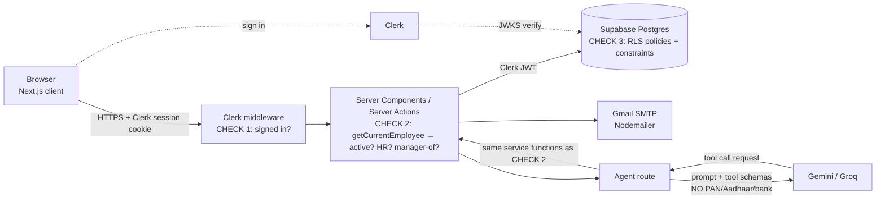

# ARCHITECTURE.md — Decision Guide

> This guide is for **you** to write ARCHITECTURE.md from. For each of the 10 sections the PDF requires, it gives what to decide, the options, a recommendation with reasons, and a likely viva question.
> Write the final document in your own words. You must be able to defend every line.

---

## 0. Stack-level gotchas found during research (read first)

| Issue | Why it matters | Recommendation |
|---|---|---|
| **Resend free plan only sends to *your own* email unless you verify a domain you own.** The test sender `onboarding@resend.dev` returns 403 for anyone else. | The checklist item "manager receives an email…" fails in the demo. | **Option A:** buy nothing; use **Brevo** (free tier, about 300 emails/day; you verify a single sender email address, no domain needed). **Option B:** Gmail SMTP via Nodemailer with an App Password. **Option C:** Resend with a free subdomain if you already own a domain. Record the choice and why. |
| **Gemini free tier is unstable.** Pro models were removed from the free tier in April 2026, and some reports say Flash is down to about 20 requests/day. Limits are per project and reset at midnight Pacific. | 15+ test prompts × up to 5 tool calls each, run after every change, could use up a day's quota. | Use the **Vercel AI SDK** so the provider is a one-line swap. Primary: **Gemini Flash**. Fallback: **Groq** (reported free limit for `llama-3.3-70b-versatile` is about 1,000 requests/day and 100K tokens/day). Check both live limit pages on the day you write this and record the numbers and date. |
| **Clerk ↔ Supabase.** The old Clerk "JWT template" was deprecated on 1 Apr 2025. | Old tutorials will mislead you. | Use the **native third-party auth integration**: add Clerk as a provider in the Supabase dashboard. RLS then reads the Clerk user ID with `auth.jwt()->>'sub'`. |

Sources: [Resend: testing-domain 403](https://resend.com/docs/knowledge-base/403-error-resend-dev-domain) · [Resend quotas](https://resend.com/docs/knowledge-base/account-quotas-and-limits) · [Gemini rate limits (official)](https://ai.google.dev/gemini-api/docs/rate-limits) · [Gemini free-tier changes 2026](https://www.cloudzero.com/blog/gemini-pricing/) · [Free LLM APIs compared – OpenRouter](https://openrouter.ai/blog/tutorials/free-llm-apis-compared/) · [Clerk Supabase integration](https://clerk.com/docs/integration/supabase)

---

## 1. Stack

| Layer | Recommended | Why | Rejected alternative + reason (pick one per layer for the doc) |
|---|---|---|---|
| Framework | **Next.js (App Router, TypeScript)** | Server Components and Server Actions give server-side role checks by default; first-class on Vercel; native fit for the AI SDK | Vite + React SPA: every role check would need a separate API layer, and it's easy to accidentally trust the client |
| Hosting | **Vercel (Hobby)** | Zero-config Next.js, env vars, preview URLs | Netlify: works, but Next.js features land on Vercel first |
| Database | **Supabase Postgres** | Real constraints (unique, FK, check, exclusion), RLS, SQL functions, free tier | Firebase/Firestore: no foreign keys or unique constraints, so "one attendance row per day" can't be enforced by the DB |
| Auth | **Clerk** | Prebuilt sign-in, user management, blocking sign-ins; PDF default | Supabase Auth: one fewer vendor, but more UI to build. Fine to mention as the alternative |
| Email | **Gmail SMTP via Nodemailer** (your choice) | Free, no domain needed, works in the demo; uses a Gmail **App Password** (needs 2-step verification) stored only in env vars | Resend: blocked without a domain (see §0); Brevo: also viable, but one more account to set up |
| AI | **Vercel AI SDK + Gemini Flash**, Groq fallback | Tool calling, `stopWhen` step limit, provider swap | LangChain: heavier, and its abstractions are harder to explain in a viva |
| UI | **Tailwind + shadcn/ui** + Recharts for dashboard charts | Fast, accessible components; fits the bold/modern design | MUI: heavier, harder to give it a distinct look |
| Validation | **Zod** shared by forms *and* server actions | One schema for PAN/IFSC/mobile rules on both sides; the server is the source of truth | — |
| Tests | **Vitest** (rules + server) + a script for agent prompts | Fast, TS-native | Jest: slower setup with ESM/TS |

**Viva question:** *"Why not just check roles in the UI?"* The browser can be edited; only the server can be trusted.

---

## 2. System diagram

Draw it in Mermaid, which renders on GitHub. It must show browser, app server, DB, auth, email, AI, and **where each role check happens**. A skeleton to adapt:



Viva point: there are **three layers of checks**. Middleware handles authentication only, server code handles authorisation, and RLS is defence in depth.

---

## 3. Data model: decisions to make and justify

### The PDF's three questions: reasoning to put in your own words

**Q: Why are statutory and bank details in separate tables?**
RLS works on **rows, not columns**. If PAN sat on `employees`, any policy that lets a manager read their reports' names would also let them read the PAN. Separate tables get stricter policies; in the recommended setup, users have **no direct SELECT at all**. Reads go through a masking function, and Reveal goes through a logging function (see §4).

**Q: Store or calculate "available balance"?**
**Calculate.** `available = opening + accrued − used − pending`. If you store it, every approval, cancellation, rejection, HR edit or accrual run must update it perfectly. One missed path or one race condition (two approvals at once) and the number drifts silently, which is the exact problem Konkan has today. A calculated value can't disagree with the requests it's built from.

**Recommended pattern:**
- `leave_balances` stores only the **opening** balance per year (carry-forward) and any HR adjustments.
- `accrued` is computed from date of joining and leave-type rules.
- `used` and `pending` are sums over `leave_requests` by status.
- Expose all of this as one SQL **view** or function, `v_leave_balance`, that the screens, the CSV *and* the agent all read. *(Alternative to mention: a ledger table `leave_transactions` with +/− rows. Strongest for auditing, but more work.)*

**Q: What stops two attendance rows for the same employee on the same date?**
A `UNIQUE (employee_id, attendance_date)` constraint. Check-in uses `INSERT … ON CONFLICT DO NOTHING`, so a double-click or two tabs can't create a second row. The database enforces it, not the button.

### Constraints to list in the ER diagram

| Table | Constraint | Enforces |
|---|---|---|
| employees | `employee_code UNIQUE`, default `'KCF' \|\| lpad(nextval('emp_code_seq')::text, 4, '0')` | E1: auto, unique, generated in the DB (no race between two HR users) |
| employees | `email UNIQUE`, `clerk_user_id UNIQUE NULL` | Login linking |
| employees | `CHECK (reporting_manager_id <> id)` + **trigger** using a recursive CTE that rejects cycles | E4: A→B→A blocked |
| employees | `CHECK (dob <= date_of_joining - interval '18 years')` | Age 18 or over at joining |
| employees | `CHECK (mobile ~ '^[6-9][0-9]{9}$')`, `CHECK (pin ~ '^[0-9]{6}$')` | Validation the DB enforces too |
| employee_statutory | `CHECK (pan ~ '^[A-Z]{5}[0-9]{4}[A-Z]$')`, `CHECK (aadhaar ~ '^[0-9]{12}$')`, `CHECK (uan IS NULL OR uan ~ '^[0-9]{12}$')` | Statutory formats |
| employee_bank | `CHECK (ifsc ~ '^[A-Z]{4}0[A-Z0-9]{6}$')` | IFSC |
| attendance | `UNIQUE (employee_id, attendance_date)`, `CHECK (check_out > check_in)` | A1 |
| leave_requests | **Exclusion constraint** (`btree_gist`): no overlapping `daterange(from,to)` for the same employee where status is `pending` or `approved` | No double-booked leave |
| leave_requests | `CHECK (approver_id <> employee_id)` | "Manager cannot approve own leave" |
| holidays | `UNIQUE (location_id, holiday_date)`, `type IN ('NATIONAL','STATE','OPTIONAL')` | A7 |
| leave_balances | `UNIQUE (employee_id, leave_type_id, year)` | One opening row per year |

**Tables to add beyond the PDF's suggestion (justify each):**
- `agent_log`: required by Module 4.
- `policy_documents`: the stored text that `explain_policy` answers from.
- `leave_drafts`, or a `status = 'draft'` on `leave_requests`: holds what the agent prepares until the user clicks Confirm.
- `sensitive_reveal_log`, or reuse `audit_log` with `field = 'REVEAL:pan'`: the PDF says Reveal "is logged".
- `email_outbox` *(optional)*: lets you retry failed emails and prove in the demo that an email was sent.

**Status design:** `employees.status` (`active`/`inactive`) **plus** `last_working_day`. Login is blocked when `today_IST > last_working_day`, so set it in the future and the person can still log in until that day.

---

## 4. Access control

**User → employee → role:**
1. The user signs in with Clerk, and `getCurrentEmployee()` runs on the server for **every** request.
2. On first login, it finds the `employees` row by **email** (case-insensitive) and saves `clerk_user_id`.
3. **No row**, or a past `last_working_day`, sends the user to `/access-denied`. Ideally also *ban* the user in Clerk on deactivation as a second layer.
4. Roles: `isHR = employees.is_hr_admin`; `isManager = EXISTS (active employee WHERE reporting_manager_id = me)`. **Never** read the role from Clerk metadata or the URL.

**Helpers every server action calls (decide the names):** `requireEmployee()`, `requireHR()`, `requireManagerOf(employeeId)`, `requireSelfOrHR(employeeId)`.
Test against URL tampering: `/employees/KCF0007` opened by KCF0003 must return 404/403 **from the server**, not from a hidden button.

**RLS: pick one approach and state it.**

| | Approach A: server does everything | **Approach B: Clerk JWT + RLS (✅ chosen)** |
|---|---|---|
| How | The server uses the Supabase service key; RLS is on but the key bypasses it | The server builds a Supabase client with the *user's* Clerk token, so RLS really applies |
| Pro | Simplest | A bug in server code still can't leak another person's PAN, which makes RLS meaningful and gives a strong viva answer |
| Con | RLS is decorative; one missed check leaks data | More SQL to write |

**Recommended RLS rules (write these as a table in your doc):**

| Table | SELECT | INSERT/UPDATE |
|---|---|---|
| employees | self; manager → direct reports; HR → all | HR only (self-service contact edits go through a narrow function) |
| **employee_statutory / employee_bank** | **No direct access for `authenticated`.** Only through `SECURITY DEFINER` functions: `get_masked_statutory(emp_id)` (self or HR → masked) and `reveal_statutory(emp_id, field)` (HR only → raw value + inserts a log row) | HR only |
| attendance | self; manager → reports; HR → all | self (today only, via the check-in function); HR corrections with a reason |
| leave_requests | self; approver/manager → reports; HR → all | self inserts own; status changes only through an `approve_leave()` function that checks approver ≠ requester |
| audit_log, agent_log | HR only | insert only through triggers/functions, never update/delete |

Masking happens in **SQL**, so no raw value ever reaches the browser or the CSV unless Reveal is used.
Masks: PAN `ABCDE****F`; Aadhaar `XXXX XXXX 1234`; bank `XXXXXX1234`.

---

## 5. Business logic location

| Rule | Recommendation | Why |
|---|---|---|
| Working-day count (weekly offs + location holidays) | **TypeScript pure function** in `lib/rules/`, called by the apply form, the server action *and* the agent tool | Unit-testable with table-driven tests, and one implementation everywhere |
| Day status (Present/Half Day/Absent/On Leave/Holiday/Weekly Off) + Late | **Pure TS function** `dayStatus(punch, leave, holiday, weeklyOff)`, computed on read. Do not store a status that can go stale | Approving leave later must automatically change the day to On Leave |
| Pro-rating and EL accrual | Pure TS functions (or the SQL view) | Tests are needed for joiners on 1 Jan, 1 Jul and 15 Jul |
| Balance totals | **SQL view** | The screens, CSV and agent read the same numbers |
| Integrity (unique, overlap, cycles, approver ≠ self) | **Database constraints/triggers** | Can't be bypassed by any code path |
| Approval | **One DB function in a transaction**: re-check the balance, set status, write audit | Prevents the race where two pending requests both "fit" the balance |

**Day status precedence (state it explicitly):**
Approved full-day leave → **On Leave** (even if they punched, per the PDF) › Holiday for their location › Weekly Off for their location › WFH → Present › hours ≥ 8 → Present, 4–<8 → Half Day, <4 or no punch → Absent. **Late** is a *flag* on top: check-in later than 10:15 IST.
Month LOP from lates = `floor(lateCount / 3) × 0.5`.

---

## 6. AI agent

- **Library:** Vercel AI SDK, `streamText` with `tools` and a **step limit of 5** (`stopWhen: stepCountIs(5)`), which enforces "max 5 tool calls".
- **Model:** Gemini Flash (free) with a Groq fallback. Record the limits and the date you checked them.
- **Tools** are thin wrappers that call the **same server functions** as the screens, with `ctx = getCurrentEmployee()` injected by the server. The model never passes "who am I", so it can't impersonate anyone.

| Tool | Input (Zod) | Output | Guard |
|---|---|---|---|
| get_my_leave_balance | none | `{type, opening, accrued, used, pending, available}[]` | self only |
| get_holidays | `{month, year}` | holidays at the user's location | — |
| count_working_days | `{from, to, halfDay?}` | `{days, excludedDates[]}` | user's location |
| explain_policy | `{question}` | matching chunks from `policy_documents` or `NOT_FOUND` | — |
| draft_leave_request | `{type, from, to, halfDay, reason}` | draft id + summary + balance check | writes only a **draft** |
| get_team_today | none | `[{name, code, status}]` | manager → direct reports only; else error |
| summarise_pending_approvals | none | pending requests + balance + clash warnings | manager/HR |
| **your extra tool** (suggestion: `month_end_attendance_check`) | `{month}` | employees with ≥3 lates or missed punches + a drafted reminder email | HR only; email sent only after HR clicks |

- **The model never sees** PAN, Aadhaar, bank details, other employees' personal data, DB keys or the service role. Enforce this by having tools return **typed DTOs** that simply don't contain those fields, rather than by asking the model nicely.
- **Write confirmation:** the draft is shown as a card with a **Confirm** button. Clicking it calls the normal `applyLeave` server action (all the same validation), never the model.
- **System prompt:** user name, location, today's date in IST, "always use a tool for any number", "you cannot approve, reject or cancel", and "if the policy text doesn't cover it, say you don't know".
- **Logging:** every tool call writes `agent_log(user, tool, inputs, result, created_at)`.

---

## 7. Folder structure (suggestion)

```
src/
  app/
    (auth)/sign-in, access-denied
    (app)/dashboard, profile, employees/[code], attendance, team,
          leave/{apply,my,calendar}, approvals, reports, ask-hr, settings
    api/agent/route.ts
  server/              # all server-only code ("server-only" import)
    auth/              # getCurrentEmployee, require* helpers
    employees/  attendance/  leave/  reports/  email/
    agent/             # tools.ts, prompt.ts, log.ts
  lib/
    rules/             # PURE functions: workingDays, dayStatus, proRate, accrual, masks
    validation/        # Zod schemas (PAN, IFSC, mobile…)
    time/ist.ts        # the ONLY place that knows about time zones
  components/ui, components/hrms
supabase/
  migrations/  seed.sql (or seed.ts)
tests/
  rules/  leave/  attendance/  security/  agent-prompts/
```

---

## 8. Dates and time zone

- **Database:** punch times are `timestamptz` (an instant, stored as UTC). Business dates (`attendance_date`, `from_date`, holiday dates) are plain `date` values, **computed in IST** when written.
- **Server:** one module `lib/time/ist.ts` exports `nowIST()`, `todayIST()` and `formatIST()`, using `Intl.DateTimeFormat` with `timeZone: 'Asia/Kolkata'` (or `date-fns-tz`). **Ban** `new Date().getDate()`, `toLocaleDateString()` without a time zone, and `toISOString().slice(0,10)` for business dates (it returns the UTC date, which is wrong between 00:00 and 05:30 IST).
- **SQL:** use `(now() AT TIME ZONE 'Asia/Kolkata')::date` wherever "today" is needed.
- **Display:** always formatted on the server or with an explicit `timeZone`.
- **Test:** run the test suite with `TZ=America/Los_Angeles` and `TZ=UTC`, and check-in at 00:30 IST must land on the IST date. (The PDF says to test by changing your laptop's time zone; do that too.)

---

## 9. Risks (pick 3 and say how you'll test each)

1. **Wrong working-day / pro-rating maths:** table-driven unit tests (Fri–Mon at HO = 2, at the plant = 3; holiday in range; join 1 Jul → CL 4, SL 3.5 → your rounding rule).
2. **Time-zone bugs** (check-in near midnight, Vercel servers run in UTC): run the test suite under different `TZ` values; test 10:14 vs 10:16 IST for the Late flag.
3. **Role bypass / URL tampering / agent prompt injection:** security tests call each server action as an employee, a manager and HR. Run the 15+ attack prompts after every change and assert on `agent_log`.
4. *(Other options: free-tier email or AI quota running out on demo day; the RLS policy being wrong while server code hides it.)*

---

## 10. Decision log

Use dated, append-only entries:

```
### 2026-11-03: Email provider changed from Resend to Gmail SMTP
Context: Resend free tier cannot email anyone but the account owner without a verified domain.
Decision: Gmail SMTP via Nodemailer with an App Password.
Consequence: from-address is my Gmail; deliverability lower; documented in README.
```

---

### Suggested writing order
§1 Stack → §3 Data model (draw the ER diagram in Mermaid `erDiagram`) → §4 Access control → §5 Logic → §8 IST → §6 Agent → §2 Diagram → §7 Folders → §9 Risks → §10 Log.
When you're done, I'll run the PDF's own review prompt against your draft (gaps, bypassable role checks, expensive-to-change decisions).
